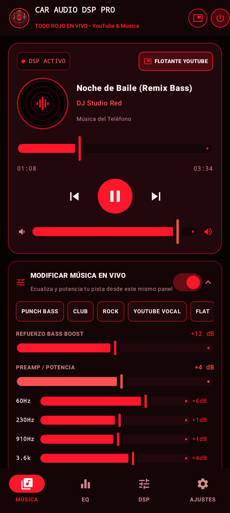
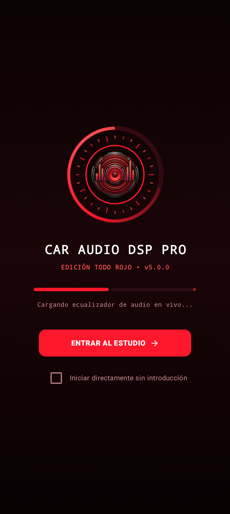

# Car Audio DSP Pro — Edición Todo Rojo (v5.0.0)

Aplicación nativa para Android desarrollada con **Kotlin** y **Jetpack Compose (Material Design 3)**, diseñada como reproductor musical local y procesador digital de audio (**AudioFX** hardware en tiempo real) para car audio, audífonos y reproducción externa como **YouTube**.

---

## Capturas de Pantalla (v5.0.0 Todo Rojo)

| Panel Principal (`MÚSICA` + Modificador) | Ecualizador Rojo (31 ISO / 15B / Paramétrico) |
| :---: | :---: |
|  |  |

| Procesador DSP Master | Pantalla de Arranque & Logo Studio |
| :---: | :---: |
|  |  |

---

## Características Principales (100% Funcionales)

1. **Carga de Música del Teléfono en el Mismo Panel (`MÚSICA`)**
   - Escanea automáticamente las pistas almacenadas en tu dispositivo (`MediaStore.Audio.Media`) con `VER MI MÚSICA` / `ACTUALIZAR`.
   - Selector múltiple `CARGAR MÚSICA` (`MP3`, `WAV`, `FLAC`, `M4A`, `OGG`) con guardado persistente.
   - **Modificador en vivo integrado:** Presets rápidos (`PUNCH BASS`, `CLUB`, `ROCK`, `YOUTUBE VOCAL`, `FLAT`), **Bass Boost (0 a +24 dB)**, **Preamp (-12 a +18 dB)** y ecualizador de 5 bandas directo sin cambiar de pantalla.

2. **Ecualizador de Precisión (`EQ`)**
   - **31 Bandas ISO** con filtro por rangos (Sub/Graves, Medios Bajos, Medios, Agudos) y curva de respuesta en vivo (20Hz – 20kHz).
   - **15 Bandas Gráficas** y **Ecualizador Paramétrico de 5 Bandas** (frecuencia central, ganancia y factor Q).
   - Creación y gestión de presets personalizados.

3. **Procesador DSP Hardware (`DSP`)**
   - Tubería **AudioFX** nativa (`DynamicsProcessing` en Android 9+ y `Equalizer` / `LoudnessEnhancer` + `BassBoost` + `Virtualizer`).
   - Medidores L/R en vivo, indicador `CLIP`, analizador de espectro, control tonal (`Preamp`, `Bass`, `Mid`, `Treble`, `Master`), amplitud estéreo, balance L/R, compresor multibanda, limitador anti-clip y filtros `HPF` / `LPF`.

4. **Pantalla Virtual Flotante Roja para YouTube**
   - Burbuja circular abierta roja flotante (`SYSTEM_ALERT_WINDOW`) al salir de la app o desde la barra superior.
   - Permite ecualizar en vivo **YouTube** u otras apps con controles rápidos de Bass Boost, Potencia, 5 bandas y presets.

---

## Requisitos y Compilación

- **Android Studio** Ladybug o superior
- **JDK:** Java 17 / 21
- **Min SDK:** 24 (Android 7.0+)
- **Target / Compile SDK:** 36

```bash
chmod +x gradlew
./gradlew assembleDebug
```

El APK generado queda en:
```
app/build/outputs/apk/debug/app-debug.apk
```

---

## Publicar Release en GitHub (v5.0.0)

```bash
git add .
git commit -m "Release v5.0.0: Edicion Todo Rojo, nuevo logo, carga musical en panel y capturas"
git tag -a v5.0.0 -m "Car Audio DSP Pro v5.0.0"
git push origin main --tags
```

Consulta [RELEASE_NOTES.md](RELEASE_NOTES.md) para ver el detalle completo de cambios de la versión `v5.0.0`.
