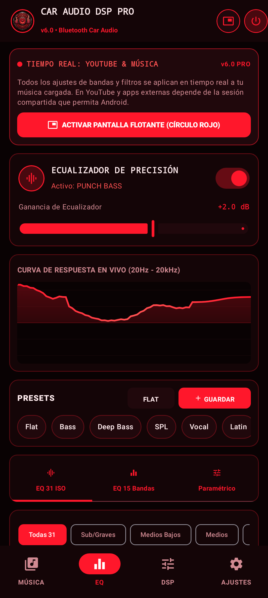
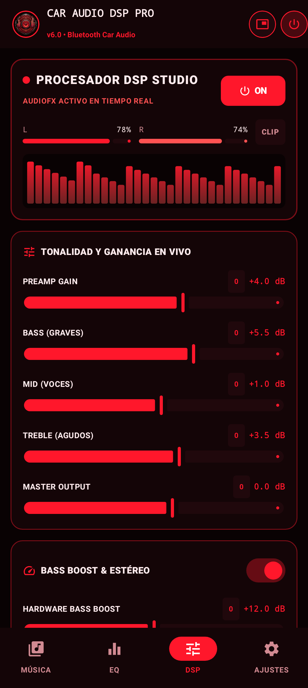
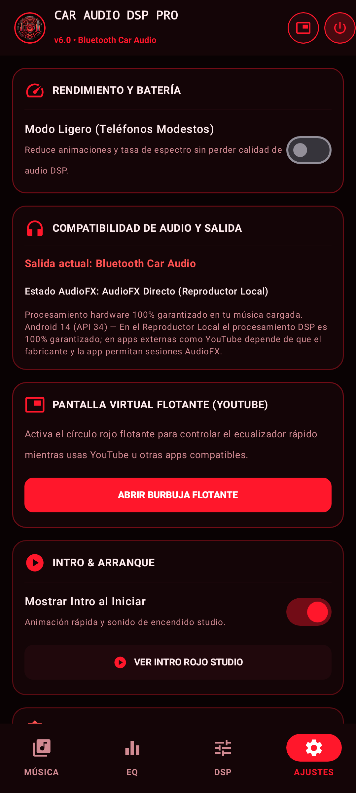

# Car Audio DSP Pro — v6.0.0 (Edición Todo Rojo)

Aplicación nativa para Android (**Kotlin + Jetpack Compose Material 3**) diseñada como reproductor musical de alta fidelidad y procesador digital de audio (**AudioFX** en tiempo real) para car audio, Bluetooth, audífonos y altavoces, conservando al 100% la identidad visual roja y negra.

---

## Capturas de Pantalla (v6.0.0)

| Panel Principal (`MÚSICA` + Modificador) | Ecualizador Rojo (31 ISO / 15B / Paramétrico) |
| :---: | :---: |
|  |  |

| Procesador DSP Master | Ajustes y Compatibilidad |
| :---: | :---: |
|  |  |

| Pantalla de Arranque & Logo Studio |
| :---: |
|  |

---

## Novedades Clave de la Versión 6.0.0

1. **Máxima Velocidad y Eficiencia (`Prioridad 1`)**
   - Limpieza de dependencias no usadas en `app/build.gradle.kts` para arranque rápido y menor peso.
   - Búferes FFT/RTA pre-asignados sin recolección de basura en bucle, pausa automática del `Visualizer` en segundo plano y caché de carátulas `AlbumArtCache` en IO.
   - `collectAsStateWithLifecycle()`, `drawWithCache` en curvas de respuesta y **Modo Ligero** automático o manual para teléfonos modestos (`isLowRamDevice`).

2. **Motor DSP de Alta Precisión (`Prioridad 2`)**
   - **31 Bandas ISO** con corte geométrico exacto, **15 Bandas Gráficas** con interpolación suave y **Paramétrico de 5 Bandas** (`Peaking`, `Low Shelf`, `High Shelf`, `Notch`).
   - Etapas `DynamicsProcessing` cacheadas con coalescencia hardware de 16 ms para mover controles sin cortes ni clics.
   - **Bass Boost**, **Preamp**, **HPF / LPF Butterworth**, **Compresor** y **Limitador anti-clipping**.

3. **Reproductor y Segundo Plano (`Prioridad 3`)**
   - Búsqueda en vivo, filtros (`Todas`, `Favoritas`, `Cargadas`), **Shuffle**, **Repetir (Off/Todo/1)** y carátulas de álbum.
   - Servicio en primer plano `CarAudioPlaybackService` con `MediaSession` y notificación `MediaStyle` compatible con controles Bluetooth/volante.
   - Detección en tiempo real de dispositivo de salida (**Bluetooth**, **USB**, **Auriculares**, **Altavoz**) y pausa automática al desconectar.

4. **Pantalla Virtual Flotante Roja y Compatibilidad Real**
   - Círculo rojo abierto flotante (`SYSTEM_ALERT_WINDOW`) para ajustes rápidos sobre otras apps.
   - Información clara de sesión activa: garantía total en música local cargada en la app; compatibilidad en YouTube/apps externas sujeta a permisos de sesión del dispositivo.

---

## Requisitos, Pruebas y Compilación

- **Android Studio** Ladybug o superior
- **JDK:** Java 17 / 21
- **Min SDK:** 24 (Android 7.0+) · **Target / Compile SDK:** 36

```bash
chmod +x gradlew
./gradlew testDebugUnitTest
./gradlew assembleDebug
```

El APK generado queda en:
```
app/build/outputs/apk/debug/app-debug.apk
```

---

## Publicar Rama `v6.0` y Release `v6.0.0` en GitHub

```bash
git checkout -b v6.0
git add .
git commit -m "Release v6.0.0: Optimizacion de rendimiento, motor DSP mejorado y MediaSession"
git tag -a v6.0.0 -m "Car Audio DSP Pro v6.0.0"
git push -u origin v6.0 --tags
```

Consulta [CHANGELOG_v6.0.md](CHANGELOG_v6.0.md) y [ARCHITECTURE_v6.0.md](ARCHITECTURE_v6.0.md) para el registro técnico detallado y [RELEASE_NOTES.md](RELEASE_NOTES.md) para las notas de lanzamiento.
