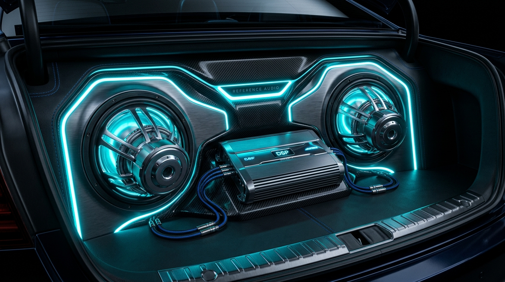
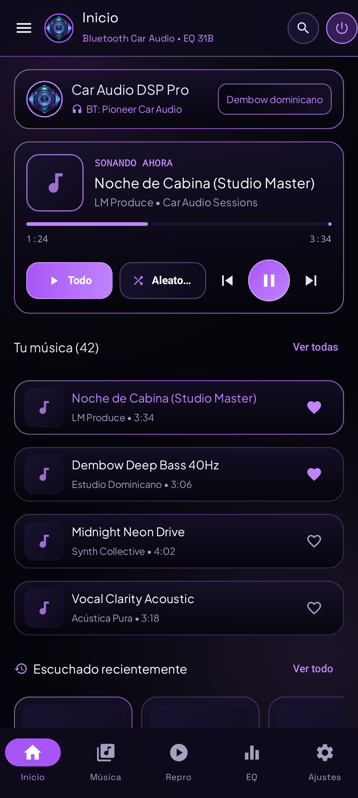
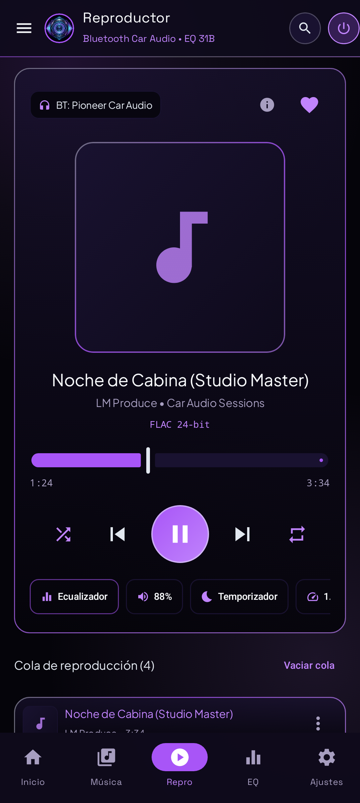
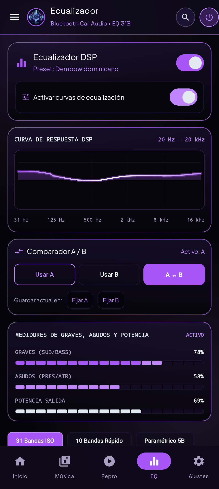
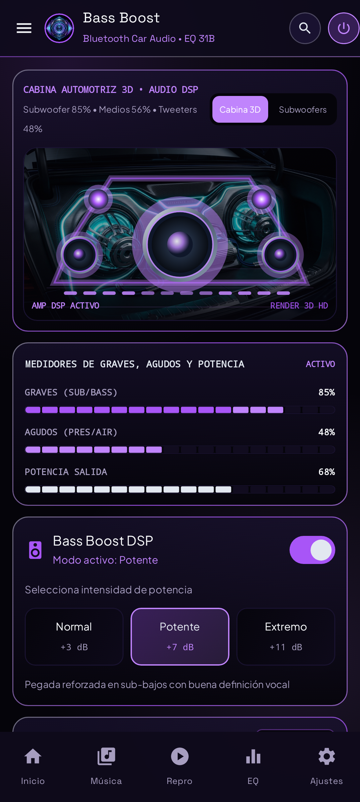
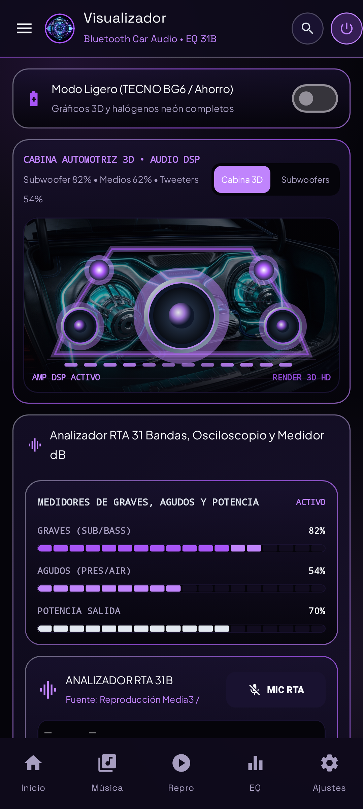
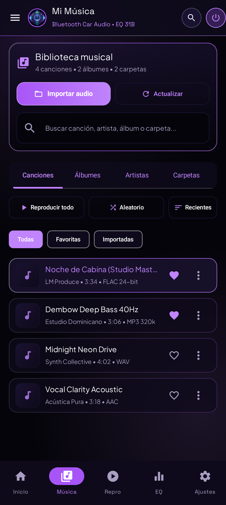
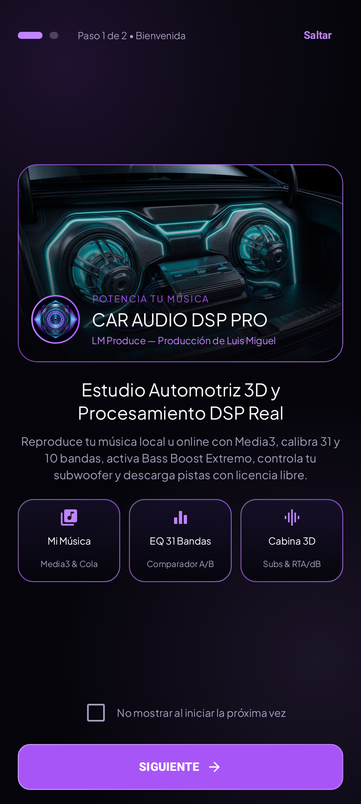
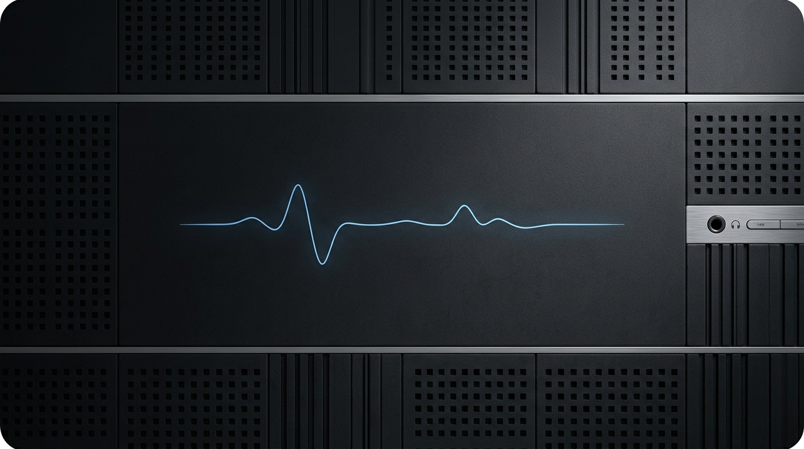

<div align="center">


# CAR AUDIO DSP PRO — v6.5.0

### *Potencia tu Música • Epic Violet DSP Pro Edition*

**LM Produce — Producción de Luis Miguel**  
Reproductor musical completo y procesador de audio DSP en tiempo real para Android, diseñado con estética **Negro OLED + Violeta Neón + Plata Estudio** y optimizado para fluidez extrema incluso en teléfonos de gama de entrada como **TECNO BG6**.

[-A855F7?style=for-the-badge)](RELEASE_NOTES.md)
[-00D4FF?style=for-the-badge&logo=android&logoColor=white)](app/build.gradle.kts)
[](app/build.gradle.kts)
[](#motor-dsp-y-arquitectura)
[](https://github.com/luismiguel38338-cmd/Car-audio-/releases)

[Características](#-ecosistema-completo-de-17-módulos) •
[Capturas Reales](#-capturas-reales-v650--epic-violet-dsp-pro) •
[Distribución Multi-Plataforma](#-listo-para-publicar-en-todas-las-plataformas) •
[Guía de Publicación](PUBLISHING_GUIDE.md) •
[Notas v6.5.0](RELEASE_NOTES.md) •
[Web Oficial y Privacidad](https://luismiguel38338-cmd.github.io/Car-audio-/)

<br />



</div>

---

## Capturas Reales v6.5.0 — Epic Violet DSP Pro

Capturas generadas directamente desde los componentes **Jetpack Compose Material 3** de la compilación `v6.5.0`:

<table>
  <tr>
    <td align="center" width="25%">
      <br />
      <sub><strong>1. Inicio Rápido</strong><br />Biblioteca, recientes y EQ</sub>
    </td>
    <td align="center" width="25%">
      <br />
      <sub><strong>2. Reproductor Pro</strong><br />Cola, timer y Media3</sub>
    </td>
    <td align="center" width="25%">
      <br />
      <sub><strong>3. EQ 31B + A/B</strong><br />Curva en vivo y medidores</sub>
    </td>
    <td align="center" width="25%">
      <br />
      <sub><strong>4. Bass Boost 3D</strong><br />Normal, Potente, Extremo</sub>
    </td>
  </tr>
  <tr>
    <td align="center" width="25%">
      <br />
      <sub><strong>5. Visualizador RTA</strong><br />Modo ligero TECNO BG6</sub>
    </td>
    <td align="center" width="25%">
      <br />
      <sub><strong>6. Mi Música</strong><br />Canciones, álbumes, carpetas</sub>
    </td>
    <td align="center" width="25%">
      <br />
      <sub><strong>7. Bienvenida Neon</strong><br />Guía rápida opcional</sub>
    </td>
    <td align="center" width="25%">
      <br />
      <sub><strong>8. Motor AudioFX</strong><br />Hardware real API 24–36</sub>
    </td>
  </tr>
</table>

---

## Ecosistema Completo de 17 Módulos

1. **Acceso Directo y Fluidez Total**
   - Entrada inmediata a la cabina musical sin registro obligatorio ni pantallas de bloqueo.
   - Sin sonidos automáticos al arrancar la aplicación.
2. **Reproductor Musical del Teléfono (`Media3 / ExoPlayer + MediaSession`)**
   - Escaneo local (`MediaStore`) por canciones, álbumes, artistas y carpetas + importación con el selector de Android (`MP3`, `FLAC`, `WAV`, `AAC`, `OGG`).
   - Reproducción continua en segundo plano y pantalla apagada, controles en notificación `MediaStyle` y Bluetooth automotriz, carátulas en caché `LruCache`, modo **Aleatorio**, **Repetir (`Off / Todo / 1`)**, cola reordenable, **Favoritas**, **Listas** y **Temporizador de apagado**.
3. **Ecualizador DSP Real (10 / 31 Bandas + Paramétrico)**
   - Procesamiento hardware mediante `DynamicsProcessing` (API 28+) y respaldo automático `Equalizer` anti-doble-procesamiento.
   - Comparador en vivo **A / B**, balance estéreo L/R, amplitud estéreo (`Virtualizer`), `Loudness`, ganancia master, compresor y limitador anti-clipping.
4. **10 Presets Calibrados por Género + Perfiles Propios**
   - *Dembow dominicano, Reggaetón, Bachata, Merengue, Trap, Hip-Hop, Electrónica, Rock, Música vocal* y *Personalizado* (más perfiles de estudio).
5. **Bass Boost + Subwoofer 3D Reactivo**
   - Modos **Normal**, **Potente** y **Extremo** (con limitador obligatorio contra saturación), ajuste de frecuencia subgrave (`30–80 Hz`), filtro subsónico y crossover `HPF / LPF`.
6. **Música Online Legal + Gestor de Descargas Offline**
   - Búsqueda real en **Jamendo API v3** (libre de derechos) con descargas offline reales con barra de progreso, pausa/reanudar HTTP `Range` y validación estricta de licencia (`audiodownload_allowed`).
   - Sección oficial de accesos directos y búsquedas en **YouTube Music** sin extracción ilegal.
7. **Visualizador RTA + Modo Ligero (TECNO BG6)**
   - Espectro de 31 bandas, osciloscopio, medidores de graves/agudos/potencia y modo visual ligero para ahorrar RAM y batería.

---

## Listo para Publicar en Todas las Plataformas

El repositorio incluye automatización completa en `.github/workflows/` y metadatos listos para tiendas en `fastlane/metadata/android/`:

| Plataforma | Formato Generado | Automatización | Ubicación / Ficha |
| :--- | :--- | :--- | :--- |
| **Google Play Store** | `.aab` firmado (`bundleRelease`) | GitHub Actions (`KEYSTORE_BASE64`) | `fastlane/metadata/android/es-ES/` & `en-US/` |
| **GitHub Releases / Directo** | `CarAudio-DSP-Pro-v6.5.0.apk` + `SHA256SUMS.txt` | Automático en push y tags `v*` | `https://github.com/luismiguel38338-cmd/Car-audio-/releases` |
| **Samsung Galaxy Store** | `.apk` Release firmado | GitHub Actions (`KEYSTORE_BASE64`) | `PUBLISHING_GUIDE.md` |
| **Amazon Appstore / AppGallery** | `.apk` Release firmado | GitHub Actions (`KEYSTORE_BASE64`) | `PUBLISHING_GUIDE.md` |
| **Obtainium / Gestores APK** | `.apk` en Releases | Enlace directo a última Release | `https://github.com/luismiguel38338-cmd/Car-audio-` |
| **Web Oficial & Privacidad** | HTML5 + Canvas + Galería | Automático vía **GitHub Pages** | `docs/index.html` & `docs/privacidad.html` |

Consulta la guía paso a paso en español en **[PUBLISHING_GUIDE.md](PUBLISHING_GUIDE.md)**.

---

## Motor DSP y Arquitectura

```text
app/src/main/java/com/example/
├── audio/        # CarAudioEngine (DynamicsProcessing, Equalizer, BassBoost, RTA FFT), AlbumArtCache
├── service/      # CarAudioPlaybackService (Media3 MediaSession), CarAudioNotificationHelper, FloatingEqualizerService
├── online/       # JamendoApiClient (API v3), OfflineDownloadManager (HTTP Range + licencia)
├── viewmodel/    # CarAudioViewModel (StateFlow reactivo, colas, persistencia y AudioFocus)
├── model/        # Modelos @Immutable (AudioModels, EqualizerModels, ThemeModel, EqPresetCatalog)
├── data/         # LocalPreferencesStore, Auth/Sync opcionales
├── ads/          # AdSlotManager (desactivado por defecto para Google Play Creator Program)
└── ui/components/# 17 pantallas Jetpack Compose + EpicDspVisualComponents + Cabina 3D
```

---

## Compilación Local y Claves API

1. **Secrets / Claves opcionales (`.env` o AI Studio Secrets):**
   Copia `.env.example` a `.env` y define `JAMENDO_CLIENT_ID` para habilitar búsquedas en el catálogo online de Jamendo API v3 (la app funciona al 100% con música local aunque la clave no esté configurada).
2. **Pruebas verificadas y compilación:**
   ```bash
   gradle :app:testDebugUnitTest \
     --tests "com.example.CarAudioEngineTest" \
     --tests "com.example.CarAudioProModulesTest" \
     --tests "com.example.CarAudioProUiRenderTest" \
     --tests "com.example.ExampleRobolectricTest" \
     --tests "com.example.ExampleUnitTest" \
     --tests "com.example.GreetingScreenshotTest"
   gradle :app:assembleDebug
   ```

---

<div align="center">

**CAR AUDIO DSP PRO v6.5.0** • Desarrollado por **LM Produce — Producción de Luis Miguel**  
Contacto: [`luismiguel38338@gmail.com`](mailto:luismiguel38338@gmail.com) • [Política de Privacidad](docs/privacidad.html)

</div>
